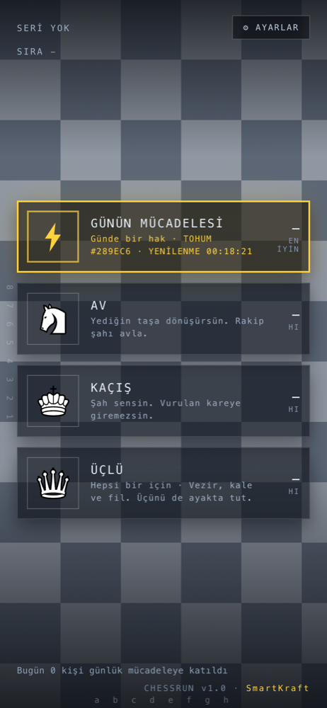
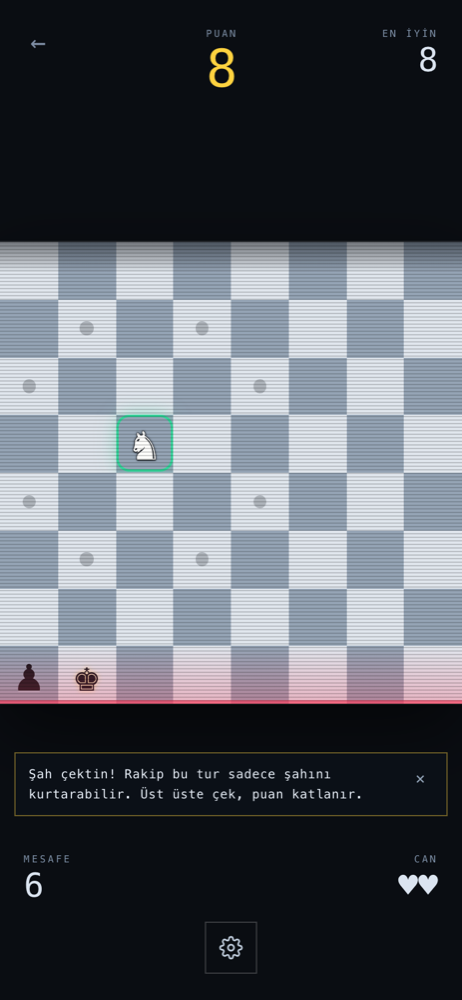
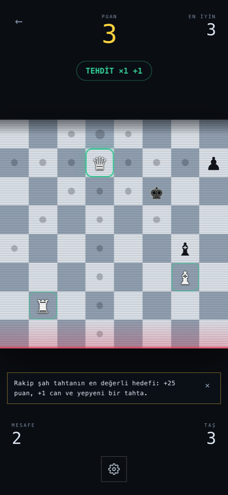

<p>
  <a href="https://remaker.ch">
    <picture>
      <source media="(prefers-color-scheme: dark)" srcset="https://remaker.ch/brand/remaker-logo-beyaz.png">
      
    </picture>
  </a>
  <br>
  <sub>SEU // Emekulas // <a href="https://github.com/smrtkrft">SmartKraft</a></sub>
</p>

# ChessRun

<p>
  
  
  
</p>

[chessrun.app](https://chessrun.app)

Sonsuz kayan bir satranç tahtasında geçen endless-runner. İki mod, ortak motor:

| Mod | Sen | Amaç |
|---|---|---|
| **ChessRun** ♞ | Yediğin taşa dönüşürsün | Rakip şahı avla |
| **Şah Kaçışı** ♚ | Şahsın, dönüşüm yok | Mat olmadan dayan |

İkisi birbirinin aynadaki yansıması: klasik modda şahı **avlıyorsun**, Şah Kaçışı'nda şah **sensin**. Her gün ikisi de aynı tohumdan doğan ortak bir tahtayı oynatıyor (günlük meydan okuma).

## Oynanış

Tahta 8 satır görünür; genişliği **oyun başında seçilir: 4–8 sütun**. Dar koridor bambaşka bir oyun — kaçacak yer az, ama düşman da az doğuyor. Bir tur üç fazdan oluşur ve her fazın kendi animasyonu vardır:

```
1. Sen oynarsın          → taşın hedefe kayar, yediğin taşa dönüşürsün
   ↳ şah yediysen        → tahta dökülür ve baştan kurulur (sadece o zaman)
2. Tahta bir satır kayar → üstten yeni satır iner, en alttaki dışarı çıkar
3. Rakip oynar           → tek taşını oynatır
```

- Yediğin taşa dönüşürsün. **Bu iki yönlü çalışır:** vezirken piyon yersen piyona düşersin. Oyunun asıl kararı budur.
- **Şah çekersen rakip savunmak zorunda.** Gerçek satrançtaki gibi: şahını kurtarmayan hiçbir hamleyi oynayamaz — ne yaklaşır, ne kuşatır. Şah çekmek bu yüzden sadece ödül avı değil, bir tempo silahı: bir turluğunu satın alırsın. **Üst üste çekersen puan katlanır** (2, 4, 6… en fazla ×5): oyunun asıl beceri ifadesi bu. Kurtaracak hamlesi yoksa (mat) donup kalmaz, başka bir taşını rastgele oynar; şah masada durur ve sen **+5** alırsın.
- **Şahı yediğinde tahta baştan kurulur.** Kareler dökülür, yenileri iner: yeni taşlar, yeni konumlar. Amacı basit — kazandığın canı aynı turda geri vermeyesin.
- **Beklemek serbest.** Satrancın "oynamak zorundasın" kuralı burada yok; bedeli bir satır geri düşmek.
- Rakip şahı yersen **+25 puan ve +1 can**. Şah senden kaçar ve yendiğinde yerine yenisi doğar — tahtada her zaman bir şah vardır.
- Rakip seni yerse ya da en alt satırda kalıp tahtadan düşersen **−1 can**. Can bitince oyun biter.

### Neden atla başlıyorsun?

Piyon değil, **at**. Kayma her turda olduğu için piyon 1 kare ilerlerken tahta onu 1 kare geri itiyor — net ilerlemesi sıfır. Hiçbir ava yetişemiyor, sadece kendisine gelen taşları bekliyor ve karşı piyonla karşılaştığında her zaman kaybediyor. At turda net 1 satır kazanabildiği için oyuncuya gerçek bir seçenek alanı bırakıyor. Değiştirmek için [`config.ts`](src/engine/config.ts) içindeki `START_PIECE`.

### Puanlama

| Taş | Piyon | At | Fil | Kale | Vezir | Şah |
|---|---|---|---|---|---|---|
| Puan | 1 | 3 | 3 | 5 | 9 | 25 (+1 can) |

### Basitleştirilmiş satranç kuralları

Bu bir satranç oyunu değil, satranç *hareketleriyle* oynanan bir runner. Bilerek dışarıda bırakılanlar:

- Rok, geçerken alma (en passant), piyonun ilk çift adımı yok.
- Piyon terfisi yok — yerine "yediğine dönüşme" mekaniği var.
- **Hamle zorunluluğu yok.** Bekleyebilirsin; bedeli bir satır geri düşmek.
- Şah mat oyunu bitirmez: rakip şahı ödül hedefi, mat da onu almanın önündeki son engelin kalkması.
- Piyon yönü tahtanın akışına bağlı: oyuncu yukarı, rakip aşağı ilerler.

## Sıkışmak ve kaybetmek

Oyun sıkıştığında **seni kurtarmaz**. Yolunu kapatan taş kaldırılmaz; kaybetmek oyunun gerçek bir parçası. Elinde kalan tek şey beklemek: tahta kayar, bir satır geriye düşersin ve pozisyon değişir.

Buna karşılık iki hesap oyuncunun lehine yapılır ([`fairness.ts`](src/engine/fairness.ts), [`game.ts`](src/engine/game.ts)):

1. **Tehlike hamleden sonraki tahtada ölçülür.** Hamle öncesi tehdit haritasına bakmak yanıltıcı: oyuncunun kendi gövdesi arkasındaki kalenin hattını kapatıyor, oyuncu ilerleyince hat açılıyor ve o kale aniden onu vuruyor. HUD'daki "güvenli hamle" sayacı bu hesaba dayanır.
2. **Kaymayla doğan pusular silinir.** Oyuncu güvenli olduğunu görerek indiği kareye, üstten yeni doğan bir kale yüzünden ölmemeli — görüp kaçınma şansı olmayan ölüm ceza değil, kaza. Hamleden *önce* de onu vuran taşlara dokunulmaz: bilerek alınan risk risktir. Temizlik tek geçişte yapılamıyor; önündeki taş kalkan bir kalenin hattı açılıyor ve o kale ancak ikinci geçişte görünür oluyor.
3. **Şah yendiğinde yeni tahtada oyuncuyu vuran taş bulunmaz.** Aynı temizlik oraya da uygulanır, üstüne çevresinde 2 kare boş bırakılır ve yeni şah uzağa konur. Oyuncu en alt satırdaysa bir yukarı alınır — yoksa kazandığı canı bir sonraki kaymada geri verirdi.

Ayrıca `score === 0` olduğu sürece yeni satıra yakalanabilir bir piyon konur — hiçbir koşu 0 puanla bitmesin diye.

## Zorluk eğrisi

Doğma oranı kare başına olasılıkla değil, **satır başına beklenen taş sayısıyla** ifade ediliyor — "her karede %5 ihtimalle taş" gibi soyut bir sayı yerine doğrudan "satırların %75'inde bir taş" diyebilmek için. Tam kısmı garanti, kesir kısmı olasılık: `1.5` → bir taş kesin, ikincisi yazı tura.

| Seviye | Beklenen | Ölçülen | Boş gelen satır |
|---|---|---|---|
| 1 (`BASE_ROW_PIECES`) | 0.75 | 0.750 | %25 |
| 5 | 1.35 | 1.356 | %0 |
| 13+ (tavan) | 2.50 | 2.496 | %0 |

Her 12 satırda bir seviye artar, her seviye satır başına `+0.15` taş getirir ve tavan 2.5'te durur. Aynı satırdaki taşlar farklı sütunlara düşer (sütunlar karıştırılıp ilk N'i seçilir).

**Genişlikle orantılı:** 4 sütunluk koridorda satır başına aynı sayıda taş doğurmak, tam tahtanın iki katı yoğunluk demekti — dar koridor "daha sıkışık bir oyun" olsun diye seçiliyor, "iki kat cezalı" olsun diye değil. Oran `× sütun / 8` ile ölçekleniyor, kare başına düşen baskı her genişlikte aynı kalıyor. 300 simüle oyunda ölçülen etki:

| Genişlik | Satır başına taş | Ortalama mesafe (önce → sonra) |
|---|---|---|
| 4 | 0.38 | 12.3 → **22.2** |
| 6 | 0.56 | 16.7 → **23.3** |
| 8 | 0.75 | 20.3 → **21.8** |

Doğan taşların dağılımında **piyon, diğer taşların toplamının üçte biri** kadar çıkar (`PAWN_SPAWN_RATIO`). Piyon kalabalığı hem tahtayı tıkıyor hem de yendiğinde oyuncuyu en zayıf taşa düşürdüğü için oyunu tekdüzeleştiriyordu.

Denge valfi: **kale veya vezirle oynarken düşman daha yoğun doğar** (satır başına `+0.25` taş). Güçlü taşa dönüşmenin bir bedeli olsun diye. Kapatmak için [`config.ts`](src/engine/config.ts) içindeki `HEAVY_PIECE_ROW_BONUS` değerini `0` yap.

## Mimari

Oyun mantığı render'dan tamamen ayrık, saf fonksiyonlar olarak yazıldı. `src/engine/` React'i hiç tanımaz; girdi olarak durum ve hamle alır, yeni durum döndürür. Böylece kurallar birim testiyle doğrulanabiliyor, arayüz değiştirilse (canvas, native, farklı motor) motor aynen taşınabiliyor.

**Rastgelelik enjekte ediliyor:** `Math.random` motorun içinden tamamen çıkarıldı, yerine tohumlanabilir bir üreteç geldi ([`engine/random.ts`](src/engine/random.ts), mulberry32). Aynı tohum + aynı hamle dizisi birebir aynı oyunu üretiyor — günlük meydan okuma, koşu tekrarı ve sunucuda doğrulanabilir skor bunun üstünde duruyor. Test bunu tahta imzalarını kare kare karşılaştırarak doğruluyor.

```
src/
  engine/            React'ten bağımsız oyun çekirdeği
    types.ts         Durum ve olay tipleri
    config.ts        Tüm dengeleme sabitleri ve zorluk fonksiyonları
    random.ts        Tohumlanabilir üreteç (mulberry32) ve yardımcıları
    moves.ts         Taş hareketleri, tehdit ve şah hesabı
    board.ts         Tahta üretimi, satır doğurma, kaydırma, yenileme
    fairness.ts      Güvenli hamle / vurulmayan kare hesabı
    ai.ts            Rakip hamle seçimi (şah altında savunma zorunluluğu)
    game.ts          Tur fazları + iki modun kuralları
    game.test.ts     Klasik mod kuralları ve bütünlük testleri
    kingrun.test.ts  Kaçış kuralları
    trio.test.ts     Üçlü: kadro, kayıp, takviye, bütünlük
    random.test.ts   Tekrarlanabilirlik: aynı tohum = aynı oyun
  components/
    Home.tsx         Ana ekran: akan tahtanın üstünde dört kart
    Settings.tsx     Ayarlar penceresi (yedi bölüm)
    Pages.tsx        Nasıl oynanır / Hakkında — tam ekran
    Game.tsx         Oyun görünümü (masaüstü konsol / mobil dört köşe)
    Board.tsx        Tahta, FLIP animasyonu, kayma, yenilenme
  ui/i18n.ts         Beş dilli düz sözlük + EN'e düşen yedek
  ui/i18n.test.ts    Sözlük bekçisi: eksik anahtar ve değişken testleri
  ui/text.ts         useT() — seçili dile bağlı çeviri kancası
  ui/settings.ts     Taş rengi / ses / dil deposu (useSyncExternalStore)
  ui/modes.ts        Ana sayfadaki mod kartları ve günün modu
  ui/ranking.ts      Sıralamanın tek okuma noktası (sunucusuz durum dâhil)
  ui/pieces.ts       Taş glifleri ve ad anahtarları
  ui/timing.ts       Faz süreleri ve hız ayarı
  ui/sound.ts        WebAudio ile üretilen retro efektler (dosya yok)
  ui/coach.ts        İlk oyunun bağlamsal ipuçları
  ui/identity.ts     Cihaz jetonu ve HMAC imzalama
  ui/scores.ts       Skor defteri, rekorlar, haftalık yarışma, günlük, seri
  ui/share.ts        Paylaşım kartı ve pano/paylaşım köprüsü
  ui/leaderboard.ts  Sunucu ucu (VITE_LEADERBOARD_URL tanımlıysa etkin)
public/
  manifest.webmanifest   PWA kimliği
  sw.js                  Çevrimdışı önbellek
  icon.svg               Uygulama ikonu (+ maskable varyantı)
```

Motor zamanlamayı hiç bilmez: turu üç saf fonksiyona bölüp arayüze veriyor, arayüz de aralarına animasyon süresi koyarak sırayla oynatıyor. Aynı fonksiyonlar testlerde animasyonsuz, arka arkaya çağrılıyor.

### Animasyon

- **Taş hareketi:** FLIP tekniği. Her taşın bir önceki karesi `offsetTop/offsetLeft` ile hatırlanıp Web Animations API ile yeni karesine kaydırılıyor. Ölçüm `transform`'dan etkilenmediği için kayma animasyonuyla çakışmıyor.
- **Satır kayması:** tahta bir satır yukarıdan başlatılıp sıfıra indiriliyor. Silinen satır "hayalet satır" olarak DOM'da bırakıldığı için gerçekten aşağı doğru dışarı çıkıyormuş gibi görünüyor — ekran zıplamıyor.
- **Tahta yenilenmesi — arcade yanıp sönmesi:** iki faz. Önce eski tahta yerinde dururken satırlar yukarıdan aşağı sırayla üç kez sert renk değiştirip eziliyor (`boardOut`, 598ms), sonra yeni tahta aynı sırayla açılıyor (`boardIn`, 558ms). Gecikme her karenin `--i` (satır indisi) değerinden geliyor, bu yüzden tarama hissi var.

  Karakteri veren şey keyframe'ler değil, **zamanlama fonksiyonu**: `steps(1, end)`. Ara kare üretilmediği için her geçiş sert kesiyor — eski donanımın yapabildiği tek şey buydu. Aynı keyframe'leri `ease` ile oynatınca efekt anında "modern" ve yumuşak görünüyor, 8-bit sertliği kayboluyor. Süreler CSS'e [`ui/timing.ts`](src/ui/timing.ts)'ten satır içi değişken olarak veriliyor ki animasyonla faz süresi ayrışmasın.
- `prefers-reduced-motion` açıksa tüm animasyonlar kapanır.

### Rakip yapay zekâsı

Rakip her tur tek bir taş oynar.

**Şah altındaysa başka hiçbir şey yapamaz.** Hamleleri, "hamleyi oyna → oyuncu hâlâ şahı vuruyor mu → geri al" testinden geçirilir; bu tek test üç savunmanın üçünü birden kapsar (şahın kaçması, şah çeken taşın yenmesi, araya girilip hattın kapatılması) ve hâlâ vurulan bir kareye kaçmayı da eler. Hiçbir hamle geçemezse mat olmuştur: elenen hamleler arasından şah dışı bir taşla rastgele biri oynanır — oyun donmaz, ama şah da kurtulmaz.

Şah çekilmemişse öncelik sırası:

1. Oyuncuyu yiyebiliyorsa yer — hem de **en ucuz taşla**, ki değerli taşlar tahtada kalsın ve oyuncuya ödül olarak dursun.
2. Şah, oyuncu 3 kare yaklaştığında kaçar.
3. Diğer taşlar oyuncuya yaklaşır; oyuncuyu vurabilecek bir kareye geçen hamle önceliklidir.

Ağırlıklar [`src/engine/ai.ts`](src/engine/ai.ts) başındaki sabitlerden ayarlanır.

## Kaçış

Şah turda 1 kare gider, tahta turda 1 satır kayar: **net ilerleme sıfır.** İlk bakışta bu bir kusur — aslında modun tamamı bunun üstüne kurulu:

> Hayatta kalmak için **her tur yukarı basmak zorundasın.** Basamadığın her tur seni bir satır dibe yaklaştırır. Elinde ~6 satırlık pay var.

Bu yüzden puan "ilerleme" değil, **dayanılan satır sayısı** — kurguda zaten dünya senin yanından akıyor.

| | Kural |
|---|---|
| Hamle | **Vurulan kareye giremezsin** (gerçek satranç şahı) |
| Yeme | Korunmasız bitişik taşı yersin, korunanı yiyemezsin |
| Ölüm | Mat (vuruluyorsun + güvenli kare yok) veya alt satırdan düşmek |
| Can | Tek — koşu keskin biter |
| Puan | Dayanılan satır + yeme puanı |

Motorda yeni kural neredeyse yok: güvenli hamle hesabı ipucu katmanı olarak zaten vardı ([`unattackedMoves`](src/engine/fairness.ts)), burada **kuralın kendisi** oluyor.

Bunun bir yan sonucu var ve testle sabitlendi: oyuncu hep vurulmayan kareye indiği ve kaymayla doğan pusular temizlendiği için **rakip onu asla yiyemez**. Geriye iki gerçek ölüm kalıyor. 300 simüle koşuda ölçülen: 20–34 satır dayanma, **%85 düşerek, %15 matla** bitiyor; turların %54–77'si tehdit altında geçiyor.

### Arcade kapanış

Koşu bittiğinde — **üç modda da** — eski atari kabinlerindeki üç perdeli kapanış oynuyor ([`ArcadeOutro.tsx`](src/components/ArcadeOutro.tsx)):

1. **Ölüm** — tahta iki kez sert sert ters renge dönüyor, sonra tüplü televizyon gibi orta çizgiye çöküp beyaz bir noktaya kadar parlayarak sönüyor.
2. **Başlık** — MAT OLDUN / OYUN BİTTİ `steps(1)` ile yanıp sönüyor, puan sayaç sayaç tırmanıyor.
3. **Tablo** — en iyi 8 koşu satır satır yukarıdan düşüyor, senin satırın yanıp sönüyor, sıran yazıyor.

Ekrana dokunmak sırayı atlıyor: izlemek isteyen izler, isteyen doğrudan tabloya geçer.

**Üç animasyonun mod dağılımı:**

| | Av | Kaçış | Üçlü |
|---|---|---|---|
| Şah yeme → tahta dökülme | ✅ | — | ✅ |
| Sıkışma → karıştırma | ✅ | ✅ | ✅ |
| Arcade kapanış → kırmızı alarm | ✅ | ✅ | ✅ |

Şah yeme animasyonu Kaçış'ta **çalışamaz**: o modda rakip şah doğmuyor (`withKing: mode !== 'kingRun'`), çünkü şah oyuncunun kendisi. Diğer ikisi üç modda da geçerli. Bitiş ekranı da tek yol: düz overlay kalktı, üç mod da aynı arcade kapanışı alıyor.


## Üçlü

Üçüncü mod tek taş değil **kadro** yönetiyor: vezir, kale ve fil senin, ama turda yalnızca **birini** oynuyorsun. Tahta yine her hamlede kayıyor, yani oynamadığın iki taş bir satır dibe iniyor.

Modun tamamı tek bir denklemin üstünde duruyor:

> N taşın varsa ve turda bir hamle oynuyorsan, oynadığın taş **en az N satır** tırmanmalı. Aksi hâlde kadronun toplam yüksekliği her tur düşer.

Üçü de kayan taş olması bu yüzden zorunlu: at ya da piyonla bu denklem kapanmıyor. Aynı sebeple kadro tavanı **4**; beşinci taş hediye değil, herkesin sırasını seyrelten bir yük olurdu.

| | Kural |
|---|---|
| Hamle | Turda tek taş. Kendi taşına dokunmak seçim, tur harcamaz |
| Dönüşüm | Yok — kadro sabit |
| Puan | Satır + yeme + **yeni tehdit** (tur başına en çok 3) + şah + mat (20) |
| Kayıp | Taş düşer ya da yenir; koşu ancak kadro tükenince biter |
| Ödül | Rakip şahı yemek eksik taşı geri getirir; kadro tamsa 4. taş katılır |
| Koridor | En dar 6 — üç kayan taş 4 sütunda birbirini kilitliyor |

Dördüncü taş her zaman **ikinci fil** ve zorunlu olarak karşı renk karede doğuyor: tek fil tahtanın yarısını hiç göremiyor.

**Ölçümle bulunan iki şey.** Tasarımda "yoğunluk kabaca iki katı" yazıyordu; 300'er koşuluk ölçüm bunun modu bitirdiğini gösterdi — çarpan 2 iken koşu 10.5 tur, 1.5'te 13.6, 1'de 20.6 sürüyor ve ancak 1'de Av (17.6) ile Kaçış (23.0) turun arasına oturuyor. İkincisi daha sertti: pusu koruması yalnızca oynanan taşa uygulanırken kadronun tamamı ortalama **6 turda** yeniyordu ve düşerek kaybedilen taş sayısı **sıfırdı** — kayma her tur bedava saldırgan doğuruyor, üç hedeften birini ıskalamıyor ve oyuncunun tek hamlesi buna yetmiyor. Koruma kadronun tamamına yayıldı; oyuncunun *kendi hamlesiyle* girdiği tehditler dokunulmadan duruyor.

Puan kaynakları da ölçüldü (300 koşu, ortalama): satır 20.5 · yeme 28.1 · şah yemek 23.3 · şah çekme 8.7 · tehdit 6.4. Tehdit puanı bilerek küçük bir pay: baskı kurmayı ödüllendiriyor ama oyunu tek başına taşımıyor.

## Günlük meydan okuma

Tohum tarihten üretiliyor (`hashSeed('2026-08-16')`), iki mod aynı tohumu paylaşıyor: **aynı gün herkeste aynı taşlar aynı yerde doğuyor.** Gün 00:00'da dönüyor, gün serisi (streak) üst üste oynanan günleri sayıyor — bugün oynanmadıysa seri dünden sayılıyor, yani gün bitmeden kırılmıyor.

Bitiş ekranındaki paylaşım kartı Wordle mantığında ama bu oyuna özgü görselle: klasik modda **dönüşüm zinciri**, Şah Kaçışı'nda dayanılan satırların çubuğu.

```
ChessRun · 16.08.2026
♞→♝→♛→♟
42 puan · 30 satır
🔥 5 gün
```

## Tempo

Bir tur **650ms** sürüyor (Normal). Eskiden 1220ms'ti: 20 turluk ortalama bir oyunun neredeyse tamamı animasyon izlemekle geçiyordu, oyuncunun eli her hamlede bir saniyeden fazla havada bekliyordu. Süreler kısaltıldı ve HUD'a bir hız anahtarı kondu:

| Ayar | Çarpan | Tur süresi |
|---|---|---|
| Yavaş | 1.6× | 1040ms |
| Normal | 1.0× | 650ms |
| Hızlı | 0.55× | 358ms |

Çarpan tek yerden ([`ui/timing.ts`](src/ui/timing.ts)) hem faz beklemelerine hem CSS animasyonlarına gidiyor — ikisi ayrışırsa animasyon yarıda kesilir. Seçim `localStorage`'da saklanıyor.

## Şah avı

Şah tahtadaki en değerli hedef ve oyunun asıl amacı: **+25 puan, +1 can, yepyeni bir tahta.** İki gösterge bunu görünür kılıyor:

- **♚ sayacı:** mevcut taşınla şaha kaç hamlede ulaşabileceğin. Genişlik ve araya giren taşlar hesaba katılarak BFS ile bulunuyor ([`movesToKing`](src/engine/game.ts)); 300 oyunluk ölçümde vakaların %94'ünde ölçülebiliyor, ortalama 3.01 hamle. Yan faydası: satranç bilmeyene taşının nasıl hareket ettiğini öğretiyor — "atken 3, file dönüşünce 1".
- **ŞAH ×N rozeti:** zincir şah çarpanı.

## Ses

Ses dosyası yok: her efekt WebAudio osilatörüyle anlık üretiliyor ([`ui/sound.ts`](src/ui/sound.ts)). Kare/testere dalga, sert atak, kısa sönüm — tahtanın yanıp sönme animasyonuyla aynı 8-bit dili. Bir turda birden çok olay olabildiği için (yedi + dönüştü + şah çekti) hepsi üst üste çalınmıyor, öncelik sırasına göre en "büyük" olay seçiliyor. Ses HUD'dan kapatılabiliyor, tercih saklanıyor.

## Arayüz göstergeleri

Tahta bilerek sade: **güvenli/tehlikeli kare boyaması yok.** Oynanabilir boş kareler nötr gri bir noktayla işaretlenir — satranç uygulamalarındaki gibi, değerlendirme oyuncunun işi. Sayısal yardım HUD'da kalır: "güvenli hamle" sayacı, ♚ uzaklık sayacı ve şah çekildiğinde yanan **ŞAH** rozeti ile rakip şahın karesindeki altın hale.

Tahtanın üstünde sabit bir **CRT tarama çizgisi** var — kayan tahtayla birlikte hareket etmiyor, çerçeveye yapışık. Retro havanın yarısını o taşıyor.

### Öğretici: modal yerine bağlamsal ipuçları

Kılavuz kareler kaldırıldığından beri satranç bilmeyen oyuncunun tutunacağı bir şey yoktu; ama oyunu durdurup ders anlatmak da runner temposunu öldürüyor. Çözüm: **tam ilgili anda çıkan, bir kez gösterilen tek satırlık ipuçları** ([`ui/coach.ts`](src/ui/coach.ts)). İlk hamlede "yeşil halkalı taş sensin", ilk dönüşümde "artık onun gibi hareket ediyorsun", ilk şahta çarpan kuralı, alt satıra yaklaşınca düşme uyarısı, hamlesi kalmayınca bekleme hatırlatması. Görülenler `localStorage`'da işaretleniyor.

## Geliştirme

```bash
npm install
npm run dev      # geliştirme sunucusu
npm test         # motor testleri
npm run build    # tip kontrolü + üretim derlemesi
npm run lint
```

## Kimlik ve skorlar — hesapsız

Kayıt, e-posta, şifre yok. Her tarayıcı ilk açılışta kendine bir **jeton** (`crypto.randomUUID`) ve bir **HMAC-SHA256 anahtarı** üretiyor; anahtar cihazdan hiç çıkmıyor. Her koşu `jeton|puan|mesafe|sütun|seviye|zaman|hafta` yükünün imzasıyla birlikte deftere yazılıyor ([`ui/identity.ts`](src/ui/identity.ts), [`ui/scores.ts`](src/ui/scores.ts)). Oyuncu istediği adı verebiliyor; ad değişse de jeton sabit kalıyor.

> **Dürüst sınır:** anahtar tarayıcıda durduğu için bu imza *kurcalamayı fark ettirir*, kararlı bir hile girişimini durduramaz — depolamayı elle düzenleyen biri kendi anahtarıyla yeniden imzalayabilir. Gerçek koruma ancak sunucuda, tohumlu bir koşunun tekrar oynatılıp doğrulanmasıyla olur. Bu yüzden tohumlu rastgelelik hâlâ listenin başında.

**Haftalık yarışma** ISO hafta anahtarıyla (`2026-W33`) çalışıyor: haftanın perşembesi hangi yıldaysa hafta o yıla ait, böylece yılbaşına denk gelen hafta ikiye bölünmüyor. Hafta pazartesi 00:00'da dönüyor, biten haftalar arşive düşüyor.

Sunucu yokken yarışma "kendi rekorunu geç" demek. `VITE_LEADERBOARD_URL` tanımlandığı anda aynı imzalı kayıtlar global tabloya gitmeye başlıyor, arayüzde başka hiçbir şey değişmiyor ([`ui/leaderboard.ts`](src/ui/leaderboard.ts)):

```
POST {url}/runs      gövde: koşu + jeton + ad + alg   → 204
GET  {url}/weekly?week=2026-W33                      → { entries: [...] }
```

## Kurulum ve dağıtım

Uygulama **PWA**: `manifest.webmanifest` + çalışma zamanı önbellekli bir service worker ([`public/sw.js`](public/sw.js)) ile bir kez açıldıktan sonra çevrimdışı çalışıyor ve ana ekrana eklenebiliyor. Service worker yalnızca üretim derlemesinde kaydediliyor; geliştirmede açık olması vite'ın sıcak yenilemesiyle çakışıyor.

Gezinme isteklerinde **önce ağ** (yeni sürüm kaçmasın), hash'li varlıklarda **önce önbellek** stratejisi var.

> İkonlar SVG. Chrome/Edge/Android bunu sorunsuz kullanıyor; iOS ana ekran ikonu için ayrıca PNG (180×180, 512×512) üretilmeli.

## Oyun ekranı

Tek işaretleme, iki yerleşim — kırılma noktası `900px`:

- **Masaüstü — konsol.** Tahta solda ve kalan yüksekliğin tamamını alıyor (1280×760'ta ~656px); sağda tek bir 384px'lik sütun yukarıdan aşağı **kullanım sıklığına göre** diziliyor: skor → tur durumu → ayarlar → rozetler → bağlantılar → reklam. Yalnızca tek kenar kullanıldığı için diğer üç kenar tahtaya kalıyor.
- **Mobil — dört köşe.** Skorlar tahtanın dört köşesine dağılıyor (puan · en iyin üstte, mesafe · can altta), ortada tahta, altta tek dokunulacak şey olarak dişli. Başka hiçbir şey yok; tahtanın etrafındaki boşluk bilerek boş.

**Tahta ölçüsü** `--cell` üstünden tek kuraldan geliyor: mobilde kare boyu ekran genişliğinin `1/8`'i ve sabit (8 sütun kenardan kenara oturuyor, dar koridor aynı kare boyuyla ortalanıp kenarları boş bırakıyor); masaüstünde kalan **yükseklik** belirliyor. İki durumda da kaydırma yok.

**Oyun içi ayarlar:** hız · ses · taş rengi · dil. Taş rengi görsel bir **deri**: motorun rengi sabit kalıyor, oyuncunun taşları seçilen renge, rakibinkiler karşıt renge boyanıyor — böylece ayar koşu ortasında da anında çalışıyor. Koridor ve sıralama pencerede kalıyor (koşuyu bozar/böler). Mobilde çıkış yolu dişlinin arkasındaki pencerede: oyun sürerken orada **menüye dön** bağlantısı beliriyor.

**Reklam alanı** yalnızca `VITE_AD_SLOT` tanımlıysa çiziliyor ve çizildiğinde alanı rezerve ediyor — yüklenince tahta zıplamıyor.

## Diller

Beş dil var ve **hepsi tam**: TR, EN, DE, ES, FR ([`ui/i18n.ts`](src/ui/i18n.ts)). Sözlük düz — anahtarlar noktalı (`home.streak`) — çünkü eksik çeviri anahtar bazında yedeğe düşüyor: önce EN, sonra TR, en son anahtarın kendisi. Ham anahtar hiçbir koşulda ekrana çıkmıyor ve bilinmeyen bir anahtar arayüzü çökertmiyor; testler bunu beş dil × tüm anahtarlar için doğruluyor.

Kapsam sabit bir listeden değil sözlüğün kendisinden hesaplanıyor ([`missingKeys`](src/ui/i18n.ts)): yeni bir metin bir dilde unutulursa test kırılıyor, ayarlar penceresi de eksiği okuyucuya söylüyor. Yani yedek mekanizması bugün boşta duruyor ama bozulmaya karşı bekçi olarak kalıyor.

## Sıradaki adımlar

- [x] Haftalık tablonun sunucu ucu — `server/src/lb.ts`, D1 (`lb_*` tabloları), panelde "Adlar" moderasyonu (18 Ağustos 2026)
- [ ] Koşu tekrarını izleme (tohum + hamle dizisi kaydı; motor zaten deterministik)
- [ ] Klavye ile oynama
- [ ] iOS için PNG ikonlar
- [ ] Yenen taş için ayrı patlama animasyonu

## Lisans

Kod [AGPL-3.0](LICENSE). Oyunu değiştirip bir sunucuda yayımlayan, değiştirdiği kaynak kodu da oyuncularla paylaşmak zorundadır.
Taş görselleri (chessnut) [Apache-2.0](LICENSES/chessnut-APACHE-2.0.txt).
