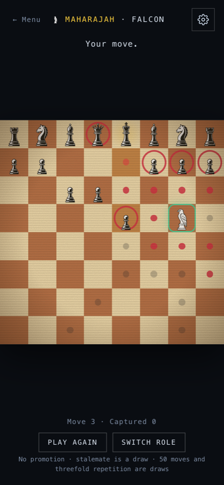

<div align="center">

<a href="https://remaker.ch">
  <picture>
    <source media="(prefers-color-scheme: dark)" srcset="https://remaker.ch/brand/remaker-logo-beyaz.png">
    
  </picture>
</a>

# ChessRun

<p><a href="https://chessrun.app"></a></p>

<p>
  
  &nbsp;&nbsp;
  
  &nbsp;&nbsp;
  
  &nbsp;&nbsp;
  
</p>

</div>

An endless runner on an endlessly scrolling chessboard. You move with chess moves, the board scrolls one row every turn, and the enemy answers. Plus Maharajah, a one-piece-against-an-army game on a classic board. Plays in the browser, no install and no account, on phone and desktop.

## Modes

| Mode | You | Goal |
|---|---|---|
| **Hunt** ♞ | You become the piece you capture | Hunt the enemy king |
| **Escape** ♚ | You are the king | Survive without being mated |
| **Trio** ♛♜♝ | A squad of three, one move per turn | Keep the squad alive |
| **Maharajah** 🦅 | Falcon: the Maharajah (queen + knight) against a whole army. Hunter: the army against the Maharajah | Falcon: mate the king. Hunter: take the Maharajah |

## In short

- Capture a piece and you become it, for better or worse.
- Take the enemy king: +25 points, +1 life and a fresh board.
- Give check and the enemy must defend; chained checks multiply the score.
- Fall off the bottom row or get taken and you lose a life.
- Daily challenge: everyone gets the same board each day, once a day.
- One weekly league for all games, no sign-up. A recovery code moves your name, badges and scores to another device.
- Maharajah: classic 8×8, no scrolling, play as often as you like. Pawns do not promote, stalemate is a draw, 50 moves or threefold repetition is a draw. Points: material (captured as Falcon, kept as Hunter on a win), +50 for a win, +10 for stalemate, +1 for every move under 50 on a win; they count in the weekly league.
- Works offline once opened (PWA). Five languages: EN, DE, TR, ES, FR.

How it all works (rules, fairness, difficulty, architecture): [design notes](docs/design.md). Piece artwork lives in [`public/figures/`](public/figures/): the source sheet `figure.png` and each figure cut out in white and black.

## Repository

| Folder | What |
|---|---|
| `src/` | The game: React UI, engines (`src/engine/`), lessons and settings (`src/ui/`) |
| `server/` | Cloudflare Worker + D1: weekly league, daily challenge, stats, recovery codes |
| `sub/` | The admin panel served by the Worker |
| `shared/` | The contract between game, Worker and panel (no dependencies) |

## Development

```bash
npm install
npm run dev      # development server
npm test         # engine tests
npm run build    # type check + production build
```

## License

Code: [AGPL-3.0](LICENSE).

---

[RE\*maker](https://remaker.ch) // SEU // Emekulas // [SmartKraft](https://github.com/smrtkrft)
