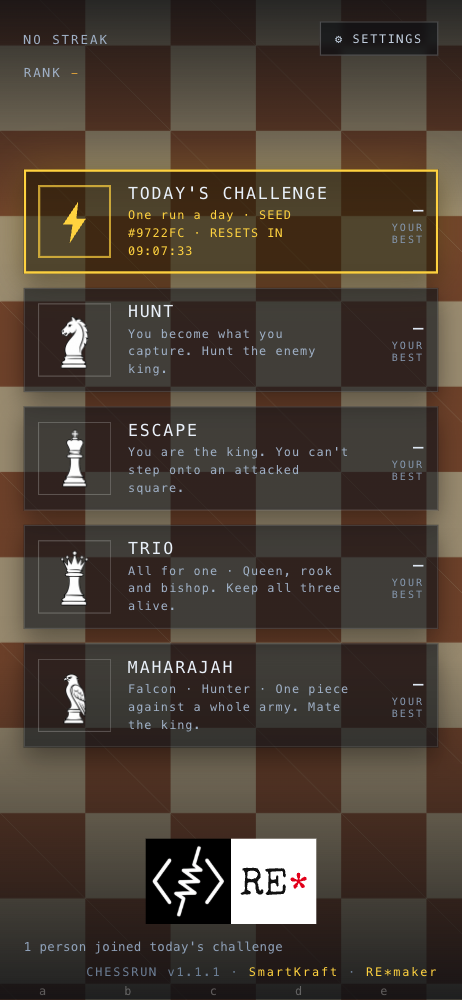
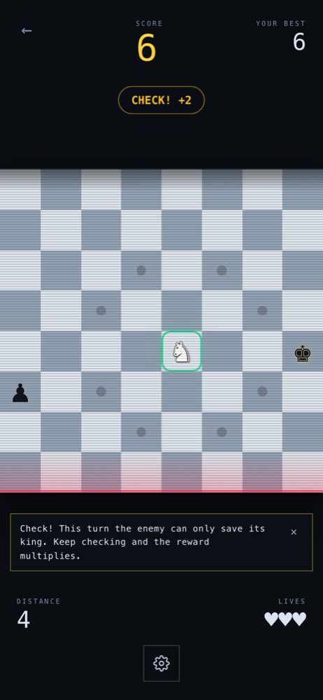
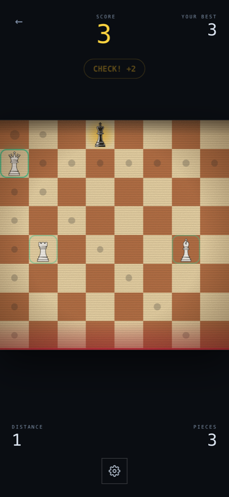

<div align="center">

<a href="https://remaker.ch">
  <picture>
    <source media="(prefers-color-scheme: dark)" srcset="https://remaker.ch/brand/remaker-logo-beyaz.png">
    
  </picture>
</a>

# ChessRun

<p><a href="https://chessrun.app"></a></p>

<p>
  
  &nbsp;&nbsp;&nbsp;
  
  &nbsp;&nbsp;&nbsp;
  
</p>

</div>

An endless runner on an endlessly scrolling chessboard. You move with chess moves, the board scrolls one row every turn, and the enemy answers. Plays in the browser, no install and no account, on phone and desktop.

## Modes

| Mode | You | Goal |
|---|---|---|
| **Hunt** ♞ | You become the piece you capture | Hunt the enemy king |
| **Escape** ♚ | You are the king | Survive without being mated |
| **Trio** ♛♜♝ | A squad of three, one move per turn | Keep the squad alive |

## In short

- Capture a piece and you become it, for better or worse.
- Take the enemy king: +25 points, +1 life and a fresh board.
- Give check and the enemy must defend; chained checks multiply the score.
- Fall off the bottom row or get taken and you lose a life.
- Daily challenge: everyone gets the same board each day. Weekly leaderboard, no sign-up.
- Works offline once opened (PWA). Five languages: EN, DE, TR, ES, FR.

How it all works (rules, fairness, difficulty, architecture): [design notes](docs/design.md).

## Development

```bash
npm install
npm run dev      # development server
npm test         # engine tests
npm run build    # type check + production build
```

## License

Code: [AGPL-3.0](LICENSE). Piece artwork (chessnut): [Apache-2.0](LICENSES/chessnut-APACHE-2.0.txt).

---

[RE\*maker](https://remaker.ch) // SEU // Emekulas // [SmartKraft](https://github.com/smrtkrft)
